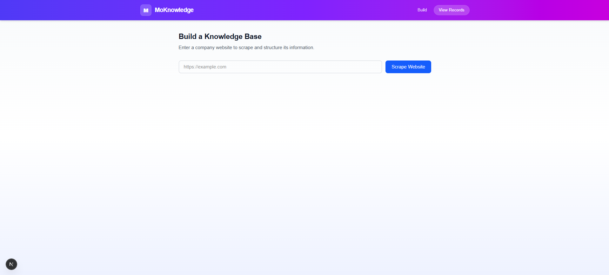
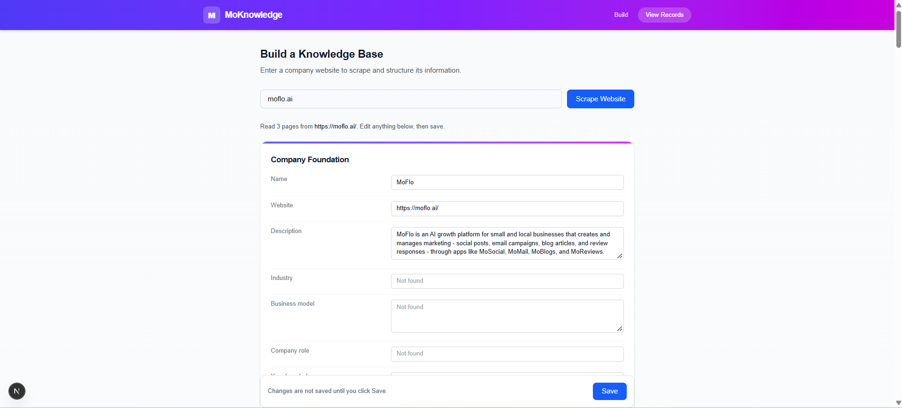
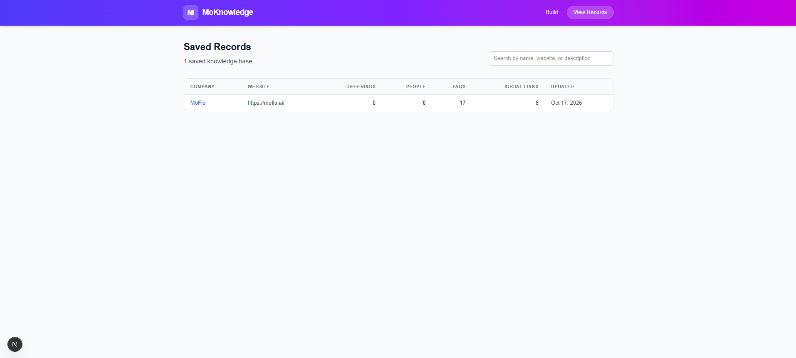

# MoKnowledge: Knowledge Builder

MoKnowledge is a web tool that scrapes a company's website and turns the extracted information into a structured, reviewable knowledge base. Each knowledge base is saved as JSON and can be edited before saving.

It is built as a prototype for the MoFlo Cloud "Knowledge" system. The knowledge base is the foundation that lets MoSocial, MoMail, and MoBlogs generate tailored, on-brand content.

## What It Does

1. **Scrape.** You enter a company website. The server fetches the homepage, finds links to key pages (About, Services, Team, Pricing, FAQ), and reads those pages too.
2. **Extract.** The scraper pulls out company details from meta tags, Open Graph tags, schema.org JSON-LD, social links, headings, paragraphs, and FAQ-style questions.
3. **Review.** Results appear in categories that match the knowledge base standard. Every field can be edited, and items can be added or removed.
4. **Save.** Records are stored on the server in `data/knowledge-records.json`, and a JSON copy is downloaded.
5. **Manage.** The View page lists saved records, supports search, and opens each record for editing or deletion.

## Pages and Endpoints

| Route | Purpose |
|---|---|
| `/knowledge` | Enter a URL, scrape it, review and edit, and save |
| `/knowledge/view` | List, search, and open saved records |
| `/knowledge/view/[id]` | Edit or delete one record |
| `GET /api/scrape?url=...` | Scrape a website and return a draft knowledge base |
| `GET /api/records` | List all saved records |
| `POST /api/records` | Save a record (adds it, or replaces the one with the same id) |
| `GET /api/records/[id]` | Get one record |
| `DELETE /api/records/[id]` | Delete one record |

## Tech Stack

- Next.js 15 with the App Router
- TypeScript
- Tailwind CSS v4
- Cheerio for HTML parsing
- React hooks for state

## Setup

Requirements: Node.js LTS (version 18 or newer) and npm.

```bash
git clone <your-repo-url> moknowledge
cd moknowledge
npm install --legacy-peer-deps
npm run dev
```

Then open `http://localhost:3000/knowledge`.

On Windows, if PowerShell reports that scripts are disabled, run `Set-ExecutionPolicy -Scope CurrentUser -ExecutionPolicy RemoteSigned` once, or use Command Prompt.

`--legacy-peer-deps` is needed because one ESLint helper package declares a peer version range that doesn't match the installed ESLint. It doesn't change how the app runs.

## Project Structure

```
src/
  app/
    knowledge/            Build page, View page, and record detail page
    api/scrape/           Scrape endpoint
    api/records/          Save, list, read, and delete endpoints
  components/             UI pieces: form, results editor, record table, header
  lib/                    Scraper logic: fetch, metadata, structured data,
                          page discovery, section extraction, record storage
  types/                  Shape of a knowledge base and API responses
data/                     Saved records (created on first save)
prompts/                  Example AI prompts for enrichment
docs/                     Schema design, data-quality strategy, screenshots
```

## How the Scraper Works

The scraper runs on the server, because browsers block cross-site requests (CORS). The process has three stages:

1. **Fetch the homepage.** The request uses an identifying User-Agent and a 10-second timeout. Redirects are followed, and the final URL is recorded.
2. **Extract from the homepage.** Metadata (title, description, logo, theme color), schema.org Organization data (name, founding date, address, `sameAs` profiles), and social links are read from the HTML.
3. **Discover and read key pages.** Internal links are matched by whole path segment (for example `/about` or `/pricing`, but not `/integrations/constant-contact`). The matched pages are fetched in parallel, and their visible text is split into heading and body sections.

Those sections become offerings (from Services and Pricing pages), people (from Team pages whose headings look like names), and FAQs (headings that end in `?`). Each FAQ records the page it came from.

Hidden content is skipped. Scripts, styles, navigation, footers, elements with the `hidden` attribute, and elements with inline `display: none` are removed before reading.

## Knowledge Base Schema

The schema is defined in `src/types/knowledge.ts`. It covers the assignment's baseline categories:

- **Company Foundation:** name, alternative names, description, website, industry, business model, role, year founded, legal entity type, employee count, addresses, service locations
- **Positioning:** pitch, founding story
- **Market & Customers:** buyers, customer needs, ideal persona, industry groupings, outlook, channels, funnels, CTAs, suppliers
- **Branding & Style:** writing style, art style, fonts, colors (hex), logos (URLs)
- **Online Presence:** social links by platform
- **Key People:** name, title, gender, background
- **Offerings:** name, category, description, features, pricing

It also includes fields beyond the baseline, marked "Think Bigger" in the code: testimonials, certifications, awards, FAQs, topics, seasonal messages, community involvement, and legal information. The full design rationale is in `docs/schema.md`, which we'll write next.

## Assumptions and Limitations

- **Pages read.** The scraper reads the homepage plus up to four key pages found through standard link names. Sites that use unusual page names may yield less.
- **Text-based extraction.** Information is extracted with rules and patterns, not AI. Names, titles, and offerings are best guesses and need review.
- **Hidden text.** Content hidden with CSS classes defined in a separate stylesheet can't be detected, so some hidden text may still appear.
- **Fields that stay empty.** Some baseline fields, such as employee count and legal entity type, are rarely published on company websites. They are left for manual entry or a later AI step.
- **Editing and re-scraping.** A record's id is derived from its website address. Scraping and saving the same site again replaces the existing record, including any edits.
- **Storage.** Records are kept in a local JSON file. This suits a prototype but is not safe for concurrent writes. The Supabase design in `docs/` addresses this.
- **Bot blocking.** Some websites block automated requests. The app reports the failure instead of crashing.
- **No live AI.** The AI enrichment described in `prompts/` is documented but not connected to any model.

## Documentation

- `prompts/` contains example prompts for turning scraped content into knowledge base fields.
- `ANSWERS.txt` contains answers to the assignment's required questions.
- [Data quality strategy](docs/data-quality.md): what happens when a field is missing or unclear

## Example AI Prompts

The `prompts/` folder contains the instructions we would give an AI model to turn the scraped text into actual knowledge base fields. An AI model isn't integrated, but the prompts show the potential utilization of AI.

- [System rules](prompts/00-system-rules.md): the ground rules every prompt follows
- [Prompt 1: Company basics](prompts/01-company-foundation.md): industry, founding year, company role, and locations

## Screenshots



